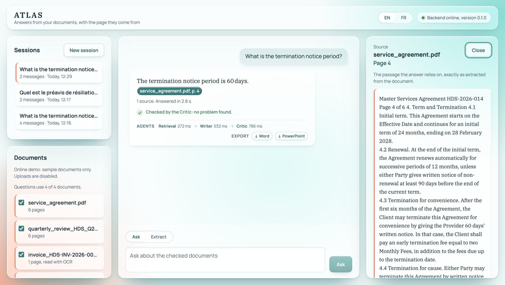
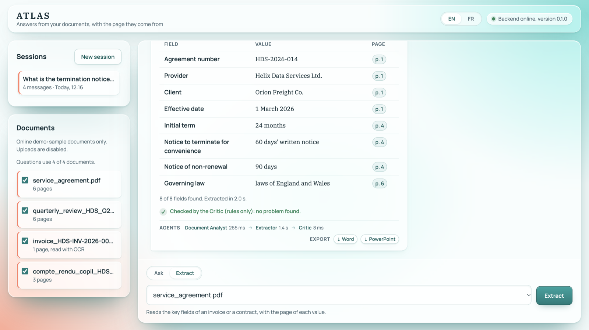
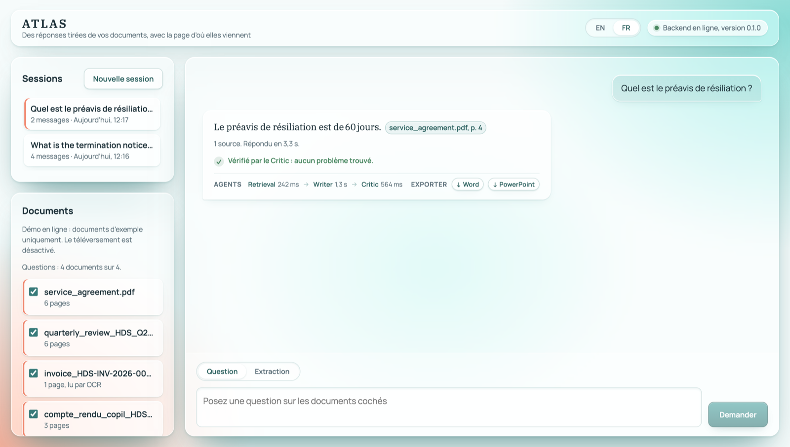
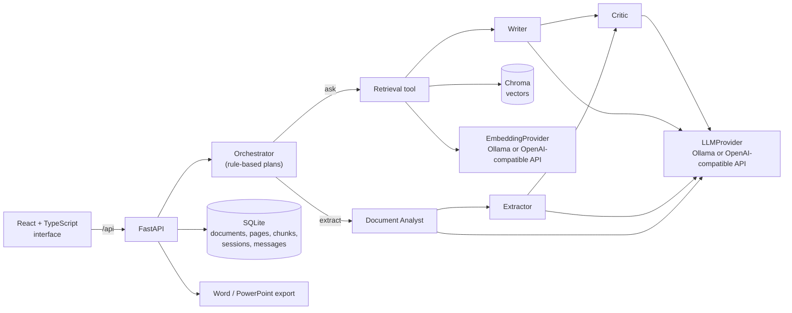

# ATLAS

**Multi-agent document intelligence: answers from your documents, with the page they come from.**

Upload professional documents (PDF, Word, PowerPoint, scanned images), ask questions or
extract key fields, and get answers that cite the exact document and page, checked by a
Critic agent. Runs fully locally with [Ollama](https://ollama.com), or online with
external APIs.

**Live demo:** https://atlas-demo-0dffb.containers.snapdeploy.app

**Demo video (1 min 38 s):** https://youtu.be/6Z7K7MAff-Y (cited answer, refusal,
extraction checked by the Critic, Word export, French interface)

> The demo runs on a free plan. After 15 minutes without visitors it goes to sleep:
> the first visit wakes it up in about **one minute**. It contains four fictional
> sample documents; uploads are disabled online.



## Contents

- [Why ATLAS](#why-atlas)
- [Features](#features)
- [Architecture](#architecture)
- [Agents](#agents)
- [Retrieval and citations](#retrieval-and-citations)
- [Evaluation](#evaluation)
- [Tech stack](#tech-stack)
- [Run it locally](#run-it-locally)
- [Online demo](#online-demo)
- [Tests](#tests)
- [Known limitations](#known-limitations)
- [Roadmap](#roadmap)
- [License](#license)

## Why ATLAS

Language models answer fluently, including when the information is not in the documents.
For contracts, invoices or business reviews, an answer is only useful if it can be
checked. ATLAS is built around that constraint:

- answers cite their sources as `[document, p. X]`, each citation opens the exact passage
  it relies on, and a sentence without a source is flagged;
- when no passage is close enough to the question, ATLAS refuses instead of guessing;
- a Critic agent checks each answer and each extraction against the sources;
- what a small model cannot guarantee (valid JSON, existing citations, numbers present in
  the sources) is checked by code, not only asked for in a prompt.

## Features

All the features below are implemented and shown in the online demo.

- **Ingestion**: PDF, DOCX, PPTX, PNG and JPG, read page by page. Scanned pages and images
  go through OCR (Tesseract).
- **Questions with citations** (retrieval-augmented generation): answers grounded in the
  retrieved passages, with clickable citations and a refusal when the information is
  absent.
- **Structured extraction**: the key fields of an invoice or a contract (numbers, dates,
  amounts, parties, notice periods), each with the page it was read from.
- **Five agents** coordinated by a rule-based orchestrator, with the trace of the agents
  that ran (and their duration) under each result.
- **Critic's verdict** on every result, split into certain problems (found by code) and
  problems to check (flagged by the model).
- **Export** of an answer or an extraction to Word (.docx) and PowerPoint (.pptx), sources
  included.
- **Session history**: conversations are saved and can be reopened.
- **English and French**: interface, answers, error messages and exports; questions can
  find passages written in the other language.
- **Local-first**: runs with Ollama and no API key; the online demo uses external APIs
  through the same interfaces.

| Extraction with the Critic's verdict | Interface in French |
|---|---|
|  |  |

## Architecture



- **SQLite is the source of truth**, including the text of every chunk. Chroma only holds
  the vectors, so the index can be rebuilt from SQLite at any time (for example after a
  change of embedding model).
- **Providers behind interfaces**: the language model, the embeddings and the vector store
  are behind small interfaces. The local setup (Ollama) and the online demo (Groq and
  Gemini) differ only by environment variables.
- **A chunk never spans two pages**, so a citation always points to one exact page.
- **Synchronous by design in V1**: no queue or worker, to keep the system simple to run on
  an 8 GB laptop.

More detail: [`docs/02_architecture.md`](docs/02_architecture.md) (in French), and every
technical decision with its alternatives in [`docs/03_decisions.md`](docs/03_decisions.md).

## Agents

| Agent | Uses the LLM | Role |
|---|---|---|
| **Orchestrator** | No (rules) | Runs an explicit plan for the chosen mode: `ask` or `extract` |
| **Document Analyst** | Yes | Recognises the type of document (invoice or contract) and selects the relevant pages |
| **Extractor** | Yes | Extracts fixed fields as JSON, validated by a schema |
| **Writer** | Yes | Writes the answer from numbered passages, citing them |
| **Critic** | Yes, plus code checks | Checks the answer or the extraction against the sources |

Retrieval is a **tool**, not an agent: it is a deterministic search that makes no
decision.

- **`ask` plan**: retrieval, then Writer, then Critic. If no passage passes the relevance
  threshold, the Writer and the Critic are not run, and the refusal is immediate.
- **`extract` plan**: Document Analyst, then Extractor, then Critic.

Each plan is a list of steps. When a step stops (for example a refusal), the following
steps are recorded as skipped, with the reason. The trace is saved with the message and
shown in the interface. A V2 replanning step can change this list after the Critic's
verdict without changing the agents.

## Retrieval and citations

1. Documents are split page by page into chunks of about 1,000 characters (150 characters
   of overlap, never across pages), embedded and indexed.
2. A question retrieves the 5 closest passages. Passages under a relevance threshold are
   dropped; if none is left, ATLAS refuses without calling the language model.
3. The Writer receives the passages as `[S1]`, `[S2]`... without file names or page
   numbers, and cites these identifiers. It answers `NOT_FOUND` when the passages do not
   contain the answer.
4. The backend checks that every cited identifier exists, removes invented ones, and turns
   the others into `[document, p. X]`. The interface makes each citation clickable.
5. The Critic checks the answer: citations, sentences without a source, numbers that appear
   in no cited passage (by code), and claims no passage supports (by the model).

The threshold depends on the embedding model and was measured on the demo documents with
criteria set before each measurement: 0.44 locally (`bge-m3`), 0.56 online (Gemini).

## Evaluation

A set of **21 questions** (10 in English, 11 in French, including 6 that must be refused)
and **2 extractions** (15 fields) with expected answers, scored by code, not by a language
model: [`eval/questions.json`](eval/questions.json).

| | Local, `qwen2.5:3b` and `bge-m3` | Online, `gpt-oss-20b` and Gemini |
|---|---|---|
| Right answers | 16 of 21 (76%) | 18 of 21 (86%) |
| Right **and** cited on an expected page | 13 of 21 (62%) | 18 of 21 (86%) |
| Extracted fields right | 15 of 15 (100%) | 15 of 15 (100%) |
| Answers in the language of the question | 14 of 15 | 12 of 14 |
| Critic false alarms on right, well-cited answers | 2 of 9 | 1 of 14 |

The two columns use different models, so they are **not directly comparable**. Detailed
results: [`eval/results.json`](eval/results.json) (local) and
[`eval/results_online.json`](eval/results_online.json) (online). Some questions of the set
were also used to calibrate the threshold, so the set is not fully independent of the
settings.

Run it against a running instance (from `backend/`):

```bash
python -m scripts.run_eval --url http://localhost:8080 --label docker
```

## Tech stack

| Layer | Choice | Why |
|---|---|---|
| Backend | Python, FastAPI | Typed, fast to build, automatic API schema |
| Frontend | React, TypeScript, Vite | Typed client copied from the API schemas |
| Storage | SQLite | Source of truth, no server to run |
| Vector store | Chroma (embedded) | Filtering by document, no server, behind an interface |
| OCR | Tesseract | Light enough for 8 GB of RAM |
| Local models | Ollama: `qwen2.5:3b`, `bge-m3` | Run on a laptop; `bge-m3` is multilingual |
| Online models | Groq `openai/gpt-oss-20b`, Google `gemini-embedding-001` | Free tiers, OpenAI-compatible APIs |
| Export | python-docx, python-pptx | Files built in memory, no LLM call |
| Deployment | Docker, GitHub Actions, GitHub Container Registry, SnapDeploy | Free, no access to the GitHub account needed by the host |

## Run it locally

Developed and tested on a MacBook Air with 8 GB of RAM (macOS).

**Requirements:** Python 3.11 or later, Node.js 20 or later,
[Ollama](https://ollama.com), Tesseract (`brew install tesseract`), and optionally Docker
Desktop.

**1. Models** (Ollama runs natively, outside Docker, to use the GPU):

```bash
ollama pull qwen2.5:3b
ollama pull bge-m3
```

**2. Backend** (from `backend/`):

```bash
python3 -m venv .venv
source .venv/bin/activate
pip install -r requirements-dev.txt
cp .env.example .env
uvicorn app.main:app --reload
```

The defaults of `.env.example` run fully locally, without any API key.

**3. Frontend** (from `frontend/`, in a second terminal):

```bash
npm ci
npm run dev
```

Open http://localhost:5173 and upload the files of [`demo_documents/`](demo_documents).

**Or with Docker Compose** (from the root, Ollama still running natively):

```bash
docker compose up -d --build
```

Open http://localhost:8080. Data is kept in a Docker volume (`docker compose down -v`
resets it).

**Using an online LLM instead of Ollama:** set `LLM_PROVIDER=openai_compatible`,
`LLM_BASE_URL`, `LLM_MODEL` and `LLM_API_KEY` in `backend/.env` (an example for Groq is at
the end of [`backend/.env.example`](backend/.env.example)). Changing the embedding model
requires re-indexing (`python -m scripts.reindex`) and a new threshold.

## Online demo

- **Image:** the [`Dockerfile`](Dockerfile) at the root builds a single container: FastAPI
  serves the API and the compiled frontend. The demo documents are read while the image is
  built (OCR included); their vectors are computed at every start, as the host has no
  persistent disk.
- **Build:** [GitHub Actions](.github/workflows/publish-image.yml) builds the image for
  ARM64 on every push to `main` and publishes it to the GitHub Container Registry. The image
  contains no key.
- **Hosting:** SnapDeploy (free plan: 512 MB, 0.25 vCPU) runs the public image. The Groq and
  Gemini keys are given to the container by the host. The host has no access to the GitHub
  account.
- **Demo mode:** uploads are refused, the interface shows a note instead of the upload
  button, and error messages describe the online service (including when its free usage
  limit is reached) instead of asking whether Ollama is running.

## Tests

| Part | Command | Tests |
|---|---|---|
| Backend | `python -m pytest -q` (from `backend/`) | 574 |
| Frontend | `npm test` (from `frontend/`) | 147 |

The backend tests run without network or models: the language model and the embeddings are
replaced by fakes, while SQLite and Chroma are tested for real. The frontend tests cover the
pure functions and the main components (React Testing Library).

## Known limitations

**Models**
- Locally, a 3B model is slower and less accurate than the online model. It is sensitive to
  the order of the passages: on "What is the termination notice period?" it can mix up the
  60-day notice with a 30-day cure period. The Critic flags this case.
- A question about information that is absent but close to the topic (such as Orion's
  revenue) can be answered with a related figure (what Orion paid). The Critic does not
  always flag it.
- Online, an English question about a French document can be answered in French.

**Documents**
- DOCX files store no reliable pagination: their sections are numbered as "pages".
- Tesseract OCR is sensitive to scan quality; table rows can be misread.
- Processing is synchronous: uploading a large document blocks the request. Limits: 20 MB,
  50 pages, 10 scanned pages per document.

**Online demo**
- Free plan: it sleeps after 15 minutes without visitors and wakes up in about one minute,
  only from a browser visit; it runs at most 100 hours a month.
- Sessions are shared between visitors and start again from zero after each wake-up.
- The free tiers of Groq (8,000 tokens per minute) and Gemini can be reached; the interface
  then asks to try again in a minute, including when a daily limit is reached.
- Uploads are disabled.
- A new image is deployed by hand on the host.

## Roadmap

**Version 2 (planned, not implemented):** asynchronous ingestion with Redis and workers,
replanning after the Critic's verdict, real-time progress over WebSocket, PostgreSQL and
Qdrant, permissions and human review, benchmarks and ablation studies, tests in continuous
integration.

## License

[MIT](LICENSE)
